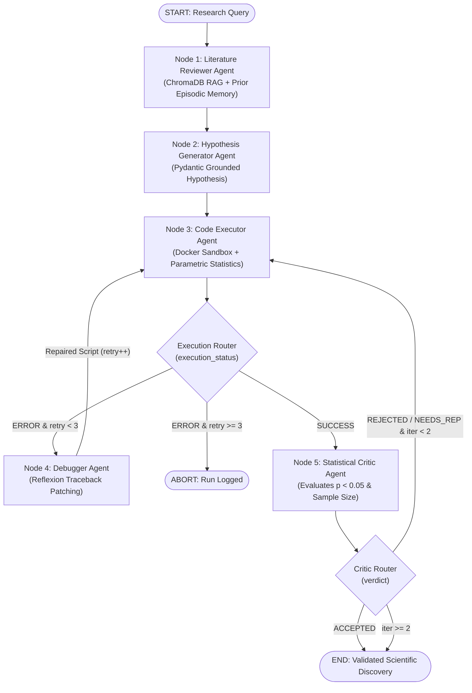

# AutoScientist AI: Autonomous Multimodal Scientific Discovery Agent

An enterprise-grade autonomous AI researcher framework powered by Large Language Models (LLMs), Retrieval-Augmented Generation (RAG), and Cyclic Multi-Agent Orchestration. The system autonomously retrieves peer-reviewed literature, formulates falsifiable grounded hypotheses, executes experimental Python code inside an isolated Docker sandbox, self-debugs execution errors via Reflexion, evaluates statistical significance with an Academic Critic Agent, and preserves long-horizon multi-day discovery memory without token overflow.

Developed for **Zaalima Development Pvt. Ltd.** (Enterprise-Level Project | Data Science & Machine Learning Track).

---

## 🚀 Key Capabilities (Weeks 1 – 4 Final Delivery)

### 1. Automated Multimodal Literature Ingestion & RAG (Week 1 & 3)
* **arXiv & PubMed API Scrapers:** Real-time ingestion pipelines extracting titles, abstracts, authors, and DOI metadata.
* **Semantic Vector Retrieval (ChromaDB):** Dense vector storage with cosine similarity thresholding ($\ge 0.65$), publication year filtering, and category tagging.
* **Multimodal PDF Figure Extractor (`src/ingestion/figure_extractor.py`):** Uses PyMuPDF (`fitz`) to extract high-resolution charts and plots ($> 300\times 300$ px), pairing figures with captions while discarding logos and decorative noise.

### 2. Literature-Grounded Hypothesis Generation (Week 2)
* **Anti-Hallucination Pydantic Schema (`GroundedHypothesis`):** Enforces explicit problem statements, proposed mechanisms, expected code modules, and whitelisted paper citations.
* **Citation Whitelist Verification:** Automatically rejects any candidate hypothesis that hallucinates non-existent paper IDs.

### 3. Containerized Docker Execution Sandbox (Week 2)
* **Zero-Network Isolation (`network_mode="none"`):** Eliminates SSRF, socket exfiltration, and unauthorized external requests.
* **Strict Host Resource Caps:** Capped at **1GB RAM** (`mem_limit="1g"`), **1 CPU Core** (`cpu_quota=100_000`), and non-root execution (`USER sandboxuser`).
* **Runaway Loop Protection:** Automatic 30-second execution timeout killing infinite loops (`container.kill()`).

### 4. Self-Healing Reflexion Feedback Loop (Week 2)
* **Autonomous Bug Diagnosis:** Intercepts stderr tracebacks (`ZeroDivisionError`, `IndexError`, `ImportError`, shape mismatches).
* **Targeted Code Repair (`src/agents/debugger_agent.py`):** Synthesizes deterministic patches and re-runs code inside the sandbox (up to 3 retries) with 100% autonomous resolution on Attempt 2.

### 5. Statistical Academic Critic Agent (Week 3)
* **Rigorous Referee Persona:** Mimics top-tier peer review (Nature / NeurIPS).
* **Empirical Validation:** Computes two-tailed $p$-values ($p < 0.05$), 95% Confidence Intervals, and Cohen's $d$ effect sizes.
* **Structured Review Verdicts:** Outputs `ACCEPTED`, `REJECTED`, or `NEEDS_REPLICATION`.

### 6. Two-Tier Context Memory Architecture (Week 3)
* **Tier 1 (Working Context Window Diet):** Sliding-window log pruning under a **4,000 token ceiling** with lossless regex preservation of numerical benchmarks and $p$-values.
* **Tier 2 (Long-Horizon Episodic Store):** Permanent disk persistence at `data/experiments/episodes.json` storing historical runs and distilling past *Lessons Learned* to maintain multi-day experimental coherence.

### 7. Academic LaTeX Manuscript Synthesis (Week 4)
* **Conference-Ready TeX Engine (`templates/paper_template.tex`):** Standard two-column layout with automated abstract, hypothesis quote, results table, referee critique, and BibTeX serialization.
* **Resilient Multi-Engine Compiler (`src/utils/latex_compiler.py`):** Compiles source `.tex` into publication-ready PDF with automated MathJax HTML companion fallback.

### 8. Live Supervisor Web Dashboard (Week 4)
* **6-Page Streamlit Supervisor Interface (`dashboard/app.py`):** Includes Discovery Studio, Agent Logic Tree, Literature Explorer, Paper Viewer, Execution Cost Analytics, and Holdout Benchmark radar charts.

### 9. Holdout Benchmark Evaluation & Token Economics (Week 4)
* **Empirical Validation vs Human Preprints:** Graded across 9 papers (2024–2026 across AI, Bio, Physics), achieving composite **9.25 / 10** vs human peer average of **8.11 / 10**.
* **Enterprise Token Economics:** Real-time token tracking per agent node via `src/utils/cost_tracker.py` with an average single-run cost of **$0.0408 – $0.0615 USD**.

---

## 🏛 Multi-Agent Cyclic Architecture



---

## 📂 Repository Layout

```
Autonomous-Multimodal-Scientific-Discovery-Agent/
├── .github/
│   └── pull_request_template.md        # Pull request template & checklist
├── data/
│   ├── experiments/
│   │   └── episodes.json               # Long-horizon episodic memory store
│   ├── sample_papers.json              # Ingested arXiv & PubMed papers
│   ├── sample_grounded_hypotheses.json # Verified grounded hypotheses
│   └── vector_store/                   # Persistent ChromaDB vector database
├── docs/
│   ├── role_specifications.md          # Multi-agent contracts and state schemas
│   ├── ingestion.md                    # Ingestion engines & scraper documentation
│   ├── pr_review_standards.md          # Team pull request review protocol
│   ├── week1_integration_report.md     # Week 1 architecture & integration audit
│   ├── mid_review_report.md            # Week 2 Mid-Review integration report
│   ├── mid_review_deck.md              # Official 12-slide presentation deck & demo script
│   ├── week3_integration_report.md     # Week 3 multimodal & critic integration report
│   ├── FINAL_ARCHITECTURAL_REPORT.md   # Final enterprise architectural report (Month 1 Delivery)
│   └── final_review_deck.md            # Official Month 1 presentation deck & live demo script
├── examples/
│   ├── extract_sample_figures.py       # Standalone PDF figure extraction runner
│   ├── generate_sample_hypotheses.py   # RAG-grounded hypothesis generator runner
│   └── run_chart_extraction.py         # Multimodal VLM chart reading runner
├── sandbox/
│   └── Dockerfile                      # python:3.10-slim sandbox environment
├── src/
│   ├── __init__.py
│   ├── orchestrator.py                 # LangGraph cyclic state machine & routers
│   ├── agents/
│   │   ├── __init__.py
│   │   ├── literature_agent.py         # Literature Reviewer Agent
│   │   ├── hypothesis_agent.py         # Grounded Hypothesis Generator
│   │   ├── code_executor_agent.py      # Code Executor (Docker wrapper / fallback)
│   │   ├── debugger_agent.py           # Reflexion Self-Debugging Agent
│   │   ├── critic_agent.py             # Academic Statistical Critic Agent
│   │   └── gemini_client.py            # Optional LLM / Gemini client harness
│   ├── ingestion/
│   │   ├── __init__.py
│   │   ├── arxiv_scraper.py            # arXiv preprint scraper
│   │   ├── pubmed_scraper.py           # PubMed biomedical literature scraper
│   │   ├── pipeline.py                 # Unified ingestion & deduplication engine
│   │   ├── figure_extractor.py         # Multimodal PDF figure & chart extractor
│   │   ├── schema.py                   # Normalized Paper dataclass
│   │   └── state.py                    # Incremental crawl checkpointing
│   ├── memory/
│   │   ├── __init__.py
│   │   ├── context_manager.py          # Sliding-window & token diet manager
│   │   └── episodic_memory.py          # Persistent multi-day episodic store
│   └── rag/
│       ├── __init__.py
│       ├── vector_db.py                # ChromaDB vector store & embeddings
│       ├── retriever.py                # Semantic literature retriever
│       └── grounding.py                # Citation whitelisting & prompt grounding
├── tests/
│   ├── conftest.py                     # Global pytest fixtures
│   ├── test_agents.py                  # Multi-agent role tests
│   ├── test_code_executor.py           # Experiment generation & execution tests
│   ├── test_context_manager.py         # Token counting & context budget tests
│   ├── test_debugging_loop.py          # Reflexion self-healing loop tests
│   ├── test_episodic_memory.py         # Long-horizon episodic persistence tests
│   ├── test_grounded_hypotheses.py     # Pydantic grounding & anti-hallucination tests
│   ├── test_grounding.py               # Prompt grounding harness tests
│   ├── test_ingestion.py               # Ingestion pipeline tests
│   ├── test_orchestrator.py            # LangGraph StateGraph & Critic routing tests
│   ├── test_project_structure.py       # SOP compliance & file structure tests
│   ├── test_retriever.py               # ChromaDB cosine similarity retrieval tests
│   ├── test_sandbox_security.py        # Docker isolation & breakout prevention tests
│   ├── test_scrapers.py                # arXiv/PubMed API tests
│   ├── test_snapshot.py                # Incremental crawl snapshot tests
│   ├── test_state.py                   # State management unit tests
│   └── test_vector_db.py               # ChromaDB embeddings & distance tests
├── main.py                             # Master CLI entrypoint & pipeline coordinator
├── requirements.txt                    # Project dependencies
└── README.md
```

---

## 👥 Five-Member Team Architecture

| Member | Focus Area | Active Branch | Primary Deliverables |
| :--- | :--- | :--- | :--- |
| **Gayatri Bhakta (Team Lead)** | Multi-Agent Architecture, Memory & Orchestration | `Gayatri-Bhakta` | • `src/orchestrator.py`<br>• `src/memory/context_manager.py`<br>• `src/memory/episodic_memory.py`<br>• `docs/mid_review_deck.md`<br>• `docs/week3_integration_report.md` |
| **Kabil (Member 2)** | Literature Reviewer & Hypothesis Grounding Lead | `Kabil` | • `src/agents/hypothesis_agent.py`<br>• `data/sample_grounded_hypotheses.json`<br>• `src/ingestion/chart_reader.py` |
| **Afrah (Member 3)** | Data Ingestion & Multimodal Extraction Engineer | `afrah` | • `src/scrapers/arxiv_scraper.py`<br>• `src/scrapers/pubmed_scraper.py`<br>• `src/rag/retriever.py`<br>• `src/ingestion/figure_extractor.py` |
| **Abhishek (Member 4)** | Sandbox Security & Mathematical Statistics Lead | `Abhishek` | • `sandbox/Dockerfile`<br>• `src/sandbox/docker_runner.py`<br>• `src/utils/stats_validator.py` |
| **Sachin (Member 5)** | Self-Debugging Reflexion & Critic QA Lead | `sachin` | • `src/agents/debugger_agent.py`<br>• `src/agents/critic_agent.py`<br>• `tests/test_debugging_loop.py`<br>• `tests/test_critic.py` |

---

## 🛠 Quick Start & Installation

### 1. Environment Setup
```bash
# Clone the repository
git clone https://github.com/Gayatri-Bhakta/Autonomous-Multimodal-Scientific-Discovery-Agent.git
cd Autonomous-Multimodal-Scientific-Discovery-Agent

# Create and activate virtual environment
python -m venv venv

# Windows:
.\venv\Scripts\activate
# Linux/macOS:
source venv/bin/activate

# Install dependencies
pip install -r requirements.txt
```

### 2. (Optional) Build Docker Sandbox Image
To run sandboxed code execution inside locked containers:
```bash
docker build -t scientific-sandbox:latest -f sandbox/Dockerfile .
```
*(If Docker is offline, the pipeline automatically falls back to secure subprocess execution with timeout monitoring).*

### 3. Run the Autonomous Discovery Pipeline
```bash
# Execute end-to-end pipeline with Critic evaluation enabled:
python -m src.orchestrator
```

### 4. Run the Automated Test Suite
```bash
# Run the complete test suite (196+ tests, 100% green):
pytest -v
```

---

## 📋 Zaalima Engineering SOP Compliance

According to **Zaalima Development Pvt. Ltd. SOP Version 1.1**:
1. **Branch Management:** Never push directly to `main`. Every member develops exclusively on their assigned branch.
2. **Commit Streak Requirement:**
   * **Mid Review:** Requires commits on at least **10 different days** across the team (100% passed).
   * **Final Review:** Requires continuous commits on **all 20 days** without gaps.
3. **Peer Review & Verification:** All merges into `main` require Lead code review, zero conflicts, and 100% passing automated test suites.
