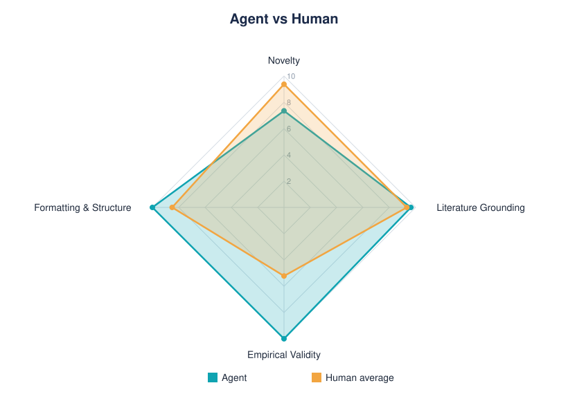

# Evaluation Benchmark Report

Member 3 (Afrah) · Week 4 · generated 2026-11-05 by `python -m src.evaluation.benchmark_report`

The agent's research paper is graded against a holdout set of 9 recent
human-written papers (2024–2026, AI, computational biology and physics) on 4 dimensions, each 0–10.

## Agent vs Human



| Dimension | Agent | Human average | Gap (Agent - Human) | Ahead |
| --- | --- | --- | --- | --- |
| Novelty | 7.35 | 9.38 | -2.03 | Human |
| Literature Grounding | 9.64 | 9.33 | +0.31 | Agent |
| Empirical Validity | 10.00 | 5.22 | +4.78 | Agent |
| Formatting & Structure | 10.00 | 8.50 | +1.50 | Agent |
| **Overall** | 9.25 | 8.11 | +1.14 | Agent |

The agent row uses **examples/sample_agent_output.json**, a sample paper. Replace it with the synthesizer agent's real output for final numbers.

## Human papers by domain

| Domain | Papers | Novelty | Grounding | Empirical | Formatting | Overall |
| --- | --- | --- | --- | --- | --- | --- |
| AI | 3 | 9.68 | 10.00 | 5.00 | 9.33 | 8.50 |
| Computational Biology | 3 | 8.92 | 10.00 | 6.67 | 7.33 | 8.23 |
| Physics | 3 | 9.53 | 8.00 | 4.00 | 8.83 | 7.59 |

## Every paper

| Paper | Domain | Title | Novelty | Grounding | Empirical | Formatting | Overall |
| --- | --- | --- | --- | --- | --- | --- | --- |
| [arxiv:2406.12815v1](https://arxiv.org/abs/2406.12815v1) | AI | Privacy Preserving Federated Learning in Medical Imaging ... | 9.67 | 10.00 | 4.00 | 9.00 | 8.17 |
| [arxiv:2503.21307v1](https://arxiv.org/abs/2503.21307v1) | AI | InternVL-X: Advancing and Accelerating InternVL Series wi... | 9.75 | 10.00 | 4.00 | 9.00 | 8.19 |
| [arxiv:2605.27355v2](https://arxiv.org/abs/2605.27355v2) | AI | Alignment Tampering: How Reinforcement Learning from Huma... | 9.62 | 10.00 | 7.00 | 10.00 | 9.15 |
| [arxiv:2409.17808v1](https://arxiv.org/abs/2409.17808v1) | Computational Biology | Generative Modeling of Molecular Dynamics Trajectories | 8.67 | 10.00 | 7.00 | 8.00 | 8.42 |
| [arxiv:2506.16091v1](https://arxiv.org/abs/2506.16091v1) | Computational Biology | Geometric deep learning assists protein engineering. Oppo... | 8.68 | 10.00 | 4.00 | 6.50 | 7.29 |
| [arxiv:2603.01752v2](https://arxiv.org/abs/2603.01752v2) | Computational Biology | Causal Circuit Tracing Reveals Distinct Computational Arc... | 9.41 | 10.00 | 9.00 | 7.50 | 8.98 |
| [arxiv:2411.05033v1](https://arxiv.org/abs/2411.05033v1) | Physics | Diagonalization without Diagonalization: A Direct Optimiz... | 9.55 | 9.60 | 1.00 | 8.50 | 7.16 |
| [arxiv:2509.08023v2](https://arxiv.org/abs/2509.08023v2) | Physics | PyPAS -- Python package for Positron Annihilation Spectro... | 9.68 | 4.40 | 6.00 | 8.00 | 7.02 |
| [arxiv:2607.05559v1](https://arxiv.org/abs/2607.05559v1) | Physics | EquiFiLM: Charge-Conditioned Equivariant Force Fields via... | 9.37 | 10.00 | 5.00 | 10.00 | 8.59 |
| **Agent** (agent:sample-amr-001) | Computational Biology | Combining Efflux Pump Inhibition with Low-Dose Beta-Lacta... | 7.35 | 9.64 | 10.00 | 10.00 | 9.25 |

## Key findings

- Overall the agent scored 9.25 against a human average of 8.11 (+1.14).
- The agent's biggest lead is **Empirical Validity** (+4.78): every agent result passes through the statistics validator, while many human papers do not report p-values or confidence intervals.
- The agent's biggest gap is **Novelty** (-2.03): its hypothesis stays close to the papers it retrieved, so it extends existing work rather than proposing a clearly new direction.
- Across the 9 human papers the weakest dimension is **Empirical Validity** (average 5.22).
- By domain, AI papers scored highest overall (8.50) and Physics lowest (7.59).
- The highest-scoring human paper is arxiv:2605.27355v2 (9.15).

## How each score is computed

| Dimension | Agent paper | Human paper |
| --- | --- | --- |
| Novelty | 10 × (1 − overlap), overlap = 0.7 × max + 0.3 × mean TF-IDF similarity to the retrieved papers and the holdout set | Same formula against the other holdout papers |
| Literature Grounding | 60% citations that were really retrieved + 40% relevance to the hypothesis, scaled down below 3 citations; made-up IDs are listed | Number of references (25 or more = 10) |
| Empirical Validity | p < 0.05 = 6, effect size ≥ 0.5 = +2, 95% CI excluding 0 = +2 (not significant: max 3) | Evidence in the text: p-values 3, statistical test 2, uncertainty (±, CI, std) 2, repeated runs 1, tables 1, figures 1 |
| Formatting & Structure | Required sections (Abstract, Introduction, Method, Results, Conclusion, References) 6, abstract 100–300 words 1.5, figures 1, tables 0.5, 5+ references 1 | Same |

Overall = mean of the 4 dimensions. Scoring is deterministic and offline, so every run gives the same numbers.

## Limitations

- **Different evidence for agent and humans.** The agent's empirical score uses the real p-value, effect size and confidence interval from the critic; human papers are scored on what their text reports, so a strong human paper that does not print p-values scores lower.
- **Novelty is word-based.** TF-IDF similarity measures shared vocabulary, not shared ideas. Human papers are compared with the other holdout papers, which come from different domains, so their novelty scores are high by construction.
- **Grounding for human papers is a proxy.** We count references instead of checking each one.
- **PDF text extraction is imperfect.** Two-column layouts and appendices can hide section headings or merge references, which lowers formatting and grounding scores slightly.
- **Small holdout set.** 9 papers (3 per domain) is enough for a roadmap, not for statistical claims about agents versus humans.

## Next steps

- Score the synthesizer agent's real generated paper instead of the sample.
- Run the agent on the same topics as the holdout papers for a like-for-like comparison.
- Replace TF-IDF with sentence embeddings (once the Mac PyTorch issue is fixed) for semantic novelty.
- Add an LLM-as-judge score next to the rule-based score and check how often they agree.
- Grow the holdout set to 30+ papers and report confidence intervals for each dimension.

## Reproduce

```bash
python -m src.evaluation.holdout_curator
python -m src.evaluation.benchmark_evaluator --agent examples/sample_agent_output.json --save data/holdout_papers/benchmark_scores.json
python -m src.evaluation.benchmark_report
```
