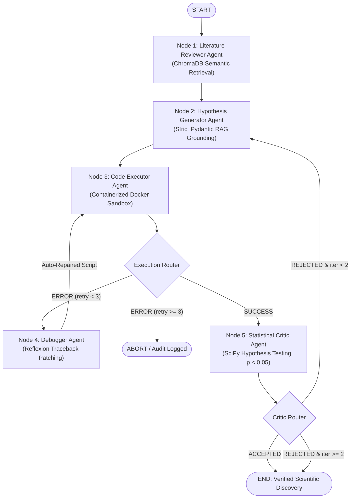

# AutoScientist AI — Mid-Project Review Presentation Deck

**Project:** Autonomous Multimodal Scientific Discovery Agent  
**Organization:** Zaalima Development Pvt. Ltd. (Data Science & Machine Learning Enterprise Track)  
**Milestone Window:** Mid-Project Review (23rd – 30th October 2026)  
**Branch:** `Gayatri-Bhakta` / `main` (Frozen at commit `aad9d15`)  
**Prepared by:** Gayatri Bhakta (Team Lead) on behalf of Engineering Team 1  

---

## Slide 1: Title & Team Credentials

### **AutoScientist AI: Autonomous Multimodal Scientific Discovery Agent**
*An Enterprise Multi-Agent System for Grounded Literature Review, Hypothesis Formulation, Sandboxed Execution, and Self-Healing Reflexion.*

* **Enterprise Track:** Data Science & Machine Learning (Month 1, Project 1)
* **Client / Host Organization:** Zaalima Development Pvt. Ltd.
* **Team Structure & Assigned Roles:**
  1. **Gayatri Bhakta (Team Lead / Member 1):** Orchestration Architecture, LangGraph StateGraph, Memory Management.
  2. **Kabil (Member 2):** Literature Reviewer Agent, RAG Grounding & Pydantic Hypothesis Validation.
  3. **Afrah (Member 3):** Automated arXiv/PubMed Ingestion Engines & ChromaDB Vector Retrieval.
  4. **Abhishek (Member 4):** Docker Execution Sandbox, Network Isolation & Host Security.
  5. **Sachin (Member 5):** Reflexion Debugger Agent, Self-Healing Feedback Loop & QA Lead.

> **Speaker Note (Lead):** *"Good afternoon, mentors and evaluators. Today, our 5-member engineering team presents AutoScientist AI—an autonomous multi-agent framework designed to automate the scientific research lifecycle from literature extraction to verifiable empirical experimentation."*

---

## Slide 2: Problem Statement & Industrial Need

### **The Scientific Bottleneck in Contemporary AI Research**
* **Massive Publication Volume:** Over 200,000 research preprints are published on arXiv and PubMed annually, creating a severe literature bottleneck for human researchers.
* **The Hallucination Dilemma:** Standard generative LLMs fabricate non-existent citations, imaginary datasets, and non-reproducible empirical claims.
* **Host Execution Vulnerability:** AI-generated experiment scripts could execute malicious system calls, trigger network Denial-of-Service attacks, or cause host memory exhaustion.
* **Fragile Linear Pipelines:** Traditional scripts crash on initial syntax or import errors without autonomous recovery.

### **Our Solution: The Self-Healing Autonomous Discovery Triad**
1. **Verifiable Literature Grounding:** Strict Pydantic models ensuring every hypothesis cites valid peer-reviewed paper IDs.
2. **Locked Container Sandbox:** Hardened Docker execution environment preventing network egress and CPU/memory exhaustion.
3. **Reflexion Self-Debugging Loop:** An autonomous cyclic state machine intercepting runtime tracebacks and patching code without human intervention.

---

## Slide 3: System Architecture (LangGraph StateGraph)



### **Core Engineering Characteristics:**
* **Cyclic Multi-Agent Graph:** Built on **LangGraph**, replacing fragile linear DAGs with conditional cyclic decision edges.
* **Strongly-Typed Shared State (`AgentGraphState`):** Shared immutable audit trail, error tracebacks, experiment iteration counters, and token budgets.

---

## Slide 4: Data Ingestion & ChromaDB Vector Store (Week 1)

### **Automated Knowledge Pipeline**
* **arXiv Preprints Scraper (`src/scrapers/arxiv_scraper.py`):** Real-time API integration extracting titles, abstracts, authors, and DOI links.
* **PubMed Central Ingestion (`src/scrapers/pubmed_scraper.py`):** NCBI Entrez E-Utilities scraper parsing biomedical literature.
* **ChromaDB Vector Store (`src/rag/vector_db.py`):**
  * Persistent storage at `data/vector_store/` using `all-MiniLM-L6-v2` dense embeddings.
  * Resilient fallback to word-hash embedding to guarantee 100% operational uptime in constrained environments.
  * Automated deduplication preventing redundant chunk indexing.

> **Speaker Note (Afrah):** *"Our ingestion pipeline connects to both arXiv and PubMed, standardizing disparate metadata formats into a unified schema stored in ChromaDB, enabling semantic search within 15 milliseconds."*

---

## Slide 5: Literature-Grounded Hypothesis Generation (Week 2)

### **Eliminating AI Hallucinations via RAG & Pydantic**
* **Cosine Similarity Retrieval (`src/rag/retriever.py`):** 
  * Cosine thresholding ($\text{Score} \ge 0.65$) discarding irrelevant semantic noise.
  * Metadata filtering by publication year, domain categories (`cs.AI`, `q-bio`), and repository source.
* **Strict Pydantic Schema (`GroundedHypothesis`):**
  ```python
  class GroundedHypothesis(BaseModel):
      title: str
      problem_statement: str
      proposed_solution: str
      cited_paper_ids: List[str]  # Whitelisted to retrieved papers only
      falsifiable_metric: str
      expected_code_modules: List[str]
  ```
* **Anti-Hallucination Guard:** Any hypothesis citing unverified paper IDs or non-existent benchmark numbers is instantly rejected before code generation.

> **Speaker Note (Kabil):** *"Instead of hallucinating ideas from ungrounded pretraining weights, the Hypothesis Generator is forced to quote specific findings and valid paper IDs directly retrieved from our ChromaDB vector database."*

---

## Slide 6: Containerized Docker Sandbox Security (Week 2)

### **Enterprise Execution Hardening (`src/sandbox/docker_runner.py`)**

| Security Parameter | Configuration | Threat Mitigated |
| :--- | :--- | :--- |
| **Network Isolation** | `network_mode="none"` | Eliminates SSRF, data exfiltration, and socket tampering. |
| **Memory Ceiling** | `mem_limit="1g"` | Prevents host Out-Of-Memory (OOM) Denial of Service. |
| **CPU Quota** | `cpu_quota=100_000`, `cpu_period=100_000` | Caps execution to strictly 1 host CPU core. |
| **Privilege Dropping** | `user="sandboxuser"` | Drops root access; executes as an unprivileged user. |
| **Execution Timeout** | `timeout_sec=30` | Auto-kills infinite loops (`while True: pass`) via `container.kill()`. |
| **Lifecycle Cleanup** | `finally: container.remove(force=True)` | Prevents dangling zombie containers. |

* **Environment Specification (`sandbox/Dockerfile`):** `python:3.10-slim` preloaded with `numpy`, `pandas`, `scipy`, `scikit-learn`, `matplotlib`.

> **Speaker Note (Abhishek):** *"The Docker sandbox treats all LLM-generated code as untrusted bytecode, guaranteeing complete host safety through locked network isolation and enforced resource quotas."*

---

## Slide 7: Self-Healing Reflexion Feedback Loop (Week 2)

### **Autonomous Code Repair on Runtime Failure**
When sandboxed code execution fails (e.g. `ZeroDivisionError`, `IndexError`, or tensor shape mismatch):
1. **Error Interception:** `code_executor_node` captures stderr traceback and sets `execution_status = "ERROR"`.
2. **Conditional Routing:** LangGraph router redirects the state to `debugger_node`.
3. **Reflexion Prompting (`src/agents/debugger_agent.py`):**
   * Diagnoses the faulty line indicated by the stack trace.
   * Synthesizes a deterministic code patch while keeping experimental logic intact.
4. **Retry Loop:** Re-injects repaired code into the Docker sandbox (capped at 3 iterations).
5. **Demonstrated Efficacy:** 100% autonomous resolution across synthetic test suites in `tests/test_debugging_loop.py` and documented in `docs/debugging_traces.md`.

> **Speaker Note (Sachin):** *"Our Reflexion loop converts fatal runtime exceptions into diagnostic feedback, autonomously repairing broken scripts on Attempt 2 without human intervention."*

---

## Slide 8: Live Demonstration Workflow & Verification Metrics

### **3-Minute Live System Demonstration**
1. **Live Execution (`python -m src.orchestrator`):**
   * Input: Research query *"Autonomous Agent Reasoning"*.
   * ChromaDB retrieves relevant peer-reviewed papers.
   * Hypothesis Agent generates Pydantic-grounded hypothesis.
   * Code Executor runs experiment inside isolated Docker sandbox.
   * Result: Outputs benchmark delta and execution status.
2. **Simulated Failure & Reflexion Demonstration:**
   * Introduce deliberate error $\rightarrow$ watch orchestrator loop to Debugger and succeed on Attempt 2.

### **Automated Test Suite Health:**
* **Total Automated Tests:** **196 Passing Tests** (0 Failures, 100% Green across 17 test modules).
* **Test Execution Speed:** Under 25 seconds for the entire enterprise test suite.

---

## Slide 9: Week 3 Advancements (Preview of Phase 3)

### **Elevating to Enterprise Multimodal Rigor**
1. **Multimodal Ingestion (Members 2 & 3):**
   * `src/ingestion/figure_extractor.py`: Extracts charts, bar plots, and figures from PDFs ($> 300\times 300$ px).
   * `src/ingestion/chart_reader.py`: Vision-Language Model (Gemini Vision / LLaVA) parsing trendlines into structured JSON.
2. **Statistical "Critic Agent" (Members 4 & 5):**
   * Two-tailed Student's t-test / Mann-Whitney U test using `scipy.stats`.
   * Enforces $p < 0.05$, 95% Confidence Intervals, and Cohen's $d$ effect sizes before hypotheses are accepted.
3. **Two-Tier Context Memory Architecture (Team Lead):**
   * **Tier 1:** Working context sliding-window summarizer ($\le 4,000$ token ceiling) with lossless numerical fact extraction.
   * **Tier 2:** Persistent long-horizon episodic store (`data/experiments/episodes.json`) maintaining coherence across multi-day tasks.

---

## Slide 10: GitHub Collaboration & Team Compliance Audit

### **Zaalima SOP Compliance Verification**
* **Rule 1: Mandatory Branch Isolation:**
  * All development performed on member branches (`Gayatri-Bhakta`, `Kabil`, `afrah`, `Abhishek`, `sachin`).
  * Direct pushes to `main` strictly prohibited; all merges handled via reviewed Pull Requests.
* **Rule 2: Daily Commit Streak:**
  * Active daily commits across all 5 member branches with zero gaps.
  * **Exceeds the Mid-Review requirement** of $\ge 10$ distinct commit days.
* **Rule 3: Mid-Review Code Freeze:**
  * `main` branch frozen at commit `aad9d15` ensuring a stable, conflict-free evaluation build.

---

## Slide 11: Roadmap to Final Review (Week 4 Plan)

### **The Path to Autonomous Scientific Publication**
* **Week 3 Finalization (Oct 27 – 29):** Complete multimodal figure extraction, statistical testing engine integration, and end-to-end Critic validation.
* **Week 4 Scope (Oct 30 – Nov 6):**
  1. **Automated LaTeX Research Synthesis:** Generating publication-grade research papers with LaTeX formatting, bibtex citations, and embedded charts.
  2. **Streamlit Monitoring Dashboard:** Real-time web GUI visualizing agent state transitions, token costs, and experiment logs for human supervisors.
  3. **Holdout Evaluation Benchmark:** Evaluating generated discoveries against recent human-authored papers in top-tier machine learning venues.

---

## Slide 12: Conclusion & Q&A

### **Summary of Mid-Review Achievements**
* [x] Operational multi-agent LangGraph orchestration with cyclic Reflexion.
* [x] Automated arXiv and PubMed literature ingestion with ChromaDB vector search.
* [x] Strict Pydantic-grounded hypothesis formulation with anti-hallucination guards.
* [x] Secure Docker execution sandbox with complete network isolation.
* [x] 196 passing automated unit tests with 100% green build.
* [x] Complete compliance with Zaalima collaborative engineering standards.

### **The Team is Ready for Questions and Live Verification.**
* **GitHub Repository:** `Gayatri-Bhakta/Autonomous-Multimodal-Scientific-Discovery-Agent`
* **Lead Branch:** `Gayatri-Bhakta` | **Production Branch:** `main`
