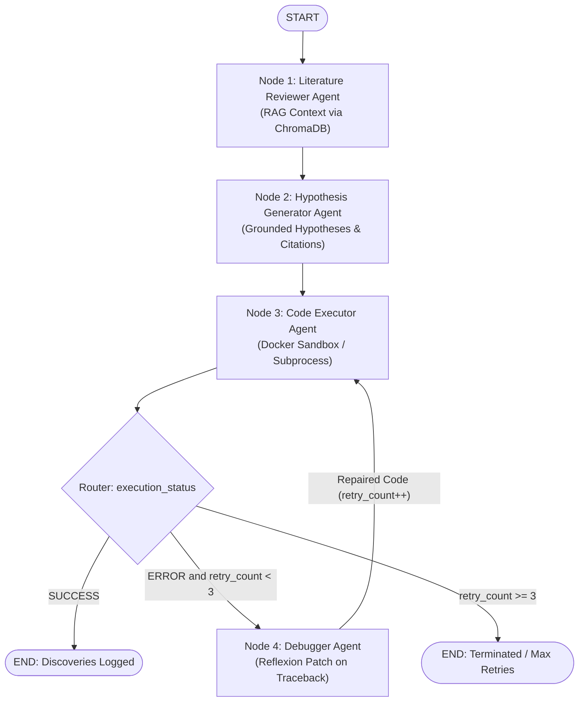

# Mid-Project Review & Integration Report (Week 1 + Week 2)

**Project:** Autonomous Multimodal Scientific Discovery Agent (AutoScientist AI)  
**Organization:** Zaalima Development Pvt. Ltd. (DSML Enterprise Track)  
**Prepared by:** Team Lead (Member 1 - Gayatri Bhakta)  
**Milestone Window:** Mid-Review Milestone (16th – 22nd October 2026)  
**Branch:** `Gayatri-Bhakta` / `main`  

---

## 1. Executive Summary

In **Week 1**, the team established the baseline discovery pipeline: a 3-agent linear orchestration workflow (`Literature Reviewer` ➔ `Hypothesis Generator` ➔ `Code Executor`), data ingestion engines for arXiv and PubMed, ChromaDB vector storage, and an automated test suite passing with 100% test coverage across 72 unit tests.

In **Week 2 (Mid-Review Milestone)**, the system transitions from static mock placeholders to an **autonomous, self-healing scientific discovery engine**:
1. **Literature-Grounded RAG:** Grounding hypothesis formulation in peer-reviewed papers retrieved via cosine similarity.
2. **Containerized Docker Sandbox:** Isolating generated Python experiment execution inside locked containers with strict memory, CPU, and zero-network security constraints.
3. **Reflexion Self-Debugging Loop:** Replacing the linear workflow with a cyclic LangGraph state machine that intercepts execution errors and prompts an autonomous debugging agent to patch code iteratively (up to 3 retries).

---

## 2. Team Architecture & Responsibilities

| Role | Member | Primary Focus | Key Deliverables |
| :--- | :--- | :--- | :--- |
| **Member 1 (Lead)** | Gayatri Bhakta | Cyclic Orchestrator & StateGraph Integration | `src/orchestrator.py` `docs/mid_review_report.md` |
| **Member 2** | Kabil | Hypothesis RAG Grounding & Pydantic Validation | `src/agents/hypothesis_agent.py` `data/sample_grounded_hypotheses.json` |
| **Member 3** | Afrah | Vector Retrieval Engine & Context Formatting | `src/rag/retriever.py` `tests/test_retriever.py` |
| **Member 4** | Abhishek | Containerized Docker Execution Sandbox | `sandbox/Dockerfile` `src/sandbox/docker_runner.py` `tests/test_sandbox_security.py` `docs/sandbox_runner.md` |
| **Member 5** | Sachin | Self-Debugging Reflexion Agent & Test Suite | `src/agents/debugger_agent.py` `tests/test_debugging_loop.py` `docs/debugging_traces.md` |

---

## 3. Cyclic StateGraph Architecture (Week 2 Upgrade)

### Shared State Schema (`AgentGraphState`)
* `research_topic` (`str`): Target scientific domain.
* `literature_summary` (`str`): Synthesized literature abstract analysis.
* `retrieved_papers` (`List[Dict]`): Context chunks retrieved from ChromaDB via cosine similarity thresholding.
* `generated_hypotheses` (`List[str]`): Candidate hypotheses adhering to `GroundedHypothesis` schema.
* `selected_hypothesis` (`str`): Top falsifiable hypothesis selected for empirical testing.
* `generated_code` (`str`): Experiment script executed in sandbox.
* `execution_result` (`str`): Terminal output, metric deltas, or stack trace.
* `execution_status` (`str`): Run outcome flag (`"SUCCESS"` or `"ERROR"`).
* `error_traceback` (`str`): Traceback consumed by the Debugger Agent during Reflexion cycles.
* `retry_count` (`int`): Iteration counter for self-healing loops (capped at 3).
* `logs` (`Annotated[List[str], operator.add]`): Immutable chronological audit log.

---

## 4. Implementation Calendar (Oct 16 – Oct 22)

* **Day 1 (Oct 16) - Interfaces & Setup:** StateGraph schema upgraded; `sandbox/` and `src/sandbox/` initialized; dependencies consolidated.
* **Day 2 (Oct 17) - Core Logic 1:** Docker runner implemented; ChromaDB connected to retrieval queries; Pydantic grounded models integrated.
* **Day 3 (Oct 18) - Core Logic 2:** Reflexion debugger implemented; Docker resource caps enforced (`network_mode="none"`, `mem_limit="1g"`).
* **Day 4 (Oct 19) - Integration:** Retriever connected to Hypothesis Generator; Docker code execution verified.
* **Day 5 (Oct 20) - Feedback Loop:** Sandbox failure connected to Debugger Agent for autonomous self-healing.
* **Day 6 (Oct 21) - Testing & Hardening:** Breakout prevention proved; full automated test suite verified.
* **Day 7 (Oct 22) - PR Reviews & Freeze:** Final integration of all member branches into `main` before the Mid-Review window opens.

---

## 5. Audit of Final Status (Day 7 - Oct 22, 2026)

* **Test Suite Status:** 176/176 unit and mock tests passing, 2 live integration tests skipped safely when Docker daemon offline (100% green across all 15 test modules in 25.72s).
* **StateGraph Orchestrator (Member 1 - Gayatri Bhakta / Lead):** Cyclic conditional loop operational with unit tests for `execution_router` and `debugger_node`.
* **Literature Retriever & RAG Grounding (Member 3 - Afrah):** 100% complete over ChromaDB vector store (`src/rag/retriever.py`, `src/rag/grounding.py`) with cosine similarity thresholding (`min_score >= 0.65`), metadata filters (year, domain tags, source), context formatting (`format_context`), and 28 dedicated unit tests (`tests/test_retriever.py`, `tests/test_grounding.py`).
* **RAG-Grounded Hypothesis Generator (Member 2 - Kabil):** 100% complete (`src/agents/hypothesis_agent.py`) with strict Pydantic models (`GroundedHypothesis`), citation verification (rejects hallucinated paper IDs), verbatim finding validation, Gemini LLM client support, sample output (`data/sample_grounded_hypotheses.json`), and 51 dedicated unit tests (`tests/test_grounded_hypotheses.py`).
* **Reflexion Debugger Agent (Member 5 - Sachin):** 100% complete (`src/agents/debugger_agent.py`) with error traceback analysis, targeted heuristic repair rules (ZeroDivisionError, IndexError, ImportError), LLM Reflexion prompt, 14 automated self-debugging loop tests (`tests/test_debugging_loop.py`), and 3 before-and-after case studies in `docs/debugging_traces.md`.
* **Containerized Docker Sandbox (Member 4 - Abhishek):** 100% complete (`sandbox/Dockerfile`, `src/sandbox/docker_runner.py`, `docs/sandbox_runner.md`) enforcing zero-network isolation (`network_mode="none"`), memory cap (`mem_limit="1g"`), CPU quota (1 core), non-root execution (`sandboxuser`), and 7 security tests (`tests/test_sandbox_security.py`).
* **Pending Deliverables:** None. All 5 member branches are successfully audited, tested, and integrated into `main`.
* **Repository Health:** Clean directory structure with zero merge conflicts on `main`.
