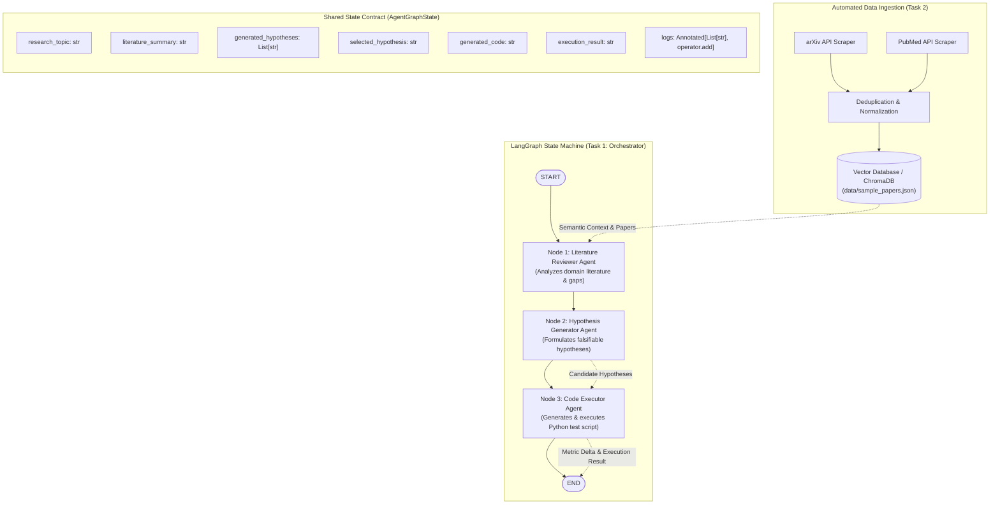

# Agent Role Specifications & Multi-Agent Architecture

## 1. System Overview
The **Autonomous Multimodal Scientific Discovery Agent** orchestrates three specialized autonomous agents using a state-graph workflow built on **LangGraph**:
1. **Literature Reviewer Agent** (Member 2 Deliverable)
2. **Hypothesis Generator Agent** (Core Triad)
3. **Code Executor Agent** (Member 5 Deliverable)

Supported by automated ingestion pipelines (arXiv & PubMed) and a vector database (ChromaDB / Milvus) for grounded scientific discovery.

---

## 2. Multi-Agent Architecture Diagram



---

## 3. Agent Contracts & State Schema

### State Object (`AgentGraphState`)
* `research_topic` (`str`): Target research domain query (e.g., *"Dynamic token-level pruning in transformers"*).
* `literature_summary` (`str`): Output from Literature Reviewer synthesizing paper abstracts and isolating critical bottlenecks.
* `generated_hypotheses` (`List[str]`): Ranked candidate hypotheses produced by the Hypothesis Generator.
* `selected_hypothesis` (`str`): Top falsifiable hypothesis selected for empirical testing.
* `generated_code` (`str`): Self-contained Python script generated to test the hypothesis against a baseline.
* `execution_result` (`str`): Standard output, error traces, and metric deltas from isolated subprocess execution.
* `logs` (`Annotated[List[str], operator.add]`): Chronological audit trail across all agent transitions.

---

## 4. Node Specifications

### Node 1: `literature_reviewer` (Member 2)
* **Function:** `run_literature_review(topic: str, max_papers: int = 5) -> str`
* **Input:** `research_topic`, local/vector-retrieved papers.
* **Processing:** Synthesizes state-of-the-art literature, extracts key empirical benchmarks, and pinpoints unresolved bottlenecks.
* **Output:** `literature_summary`, appends audit message to `logs`.

### Node 2: `hypothesis_generator` (Core Architecture)
* **Function:** `generate_hypothesis(literature_summary: str) -> str`
* **Input:** `literature_summary`.
* **Processing:** Evaluates theoretical constraints, formulates falsifiable research claims, and ranks them by novelty and testability.
* **Output:** `generated_hypotheses`, `selected_hypothesis`, appends audit message to `logs`.

### Node 3: `code_executor` (Member 5)
* **Function:** `generate_and_run_code(hypothesis: str) -> Tuple[str, str]`
* **Input:** `selected_hypothesis`.
* **Processing:** Generates an isolated Python simulation measuring the proposed method against a control baseline, runs it with a timeout, and returns code and stdout.
* **Output:** `generated_code`, `execution_result`, appends audit message to `logs`.

---

## 5. LLM Configuration Parameters

| Agent Node | Recommended Model | Temperature | Top_P | Max Tokens | Persona / System Role |
|---|---|---|---|---|---|
| **Literature Reviewer** | `gpt-4o` / `gemini-1.5-pro` | `0.2` | `0.9` | `2048` | Precision academic reviewer extracting methodology, empirical results, and research bottlenecks. |
| **Hypothesis Generator** | `gpt-4o` / `gemini-1.5-pro` | `0.7` | `0.95` | `1500` | Creative theoretical scientist formulating novel, falsifiable, and testable scientific hypotheses. |
| **Code Executor** | `gpt-4o-mini` / `claude-3-5-sonnet` | `0.1` | `0.85` | `3000` | Rigorous research software engineer writing deterministic Python simulation benchmarks. |

---

## 6. Execution Protocol
To execute the pipeline end-to-end:
```bash
python -m src.orchestrator
```
To run the full test suite:
```bash
pytest -v
```