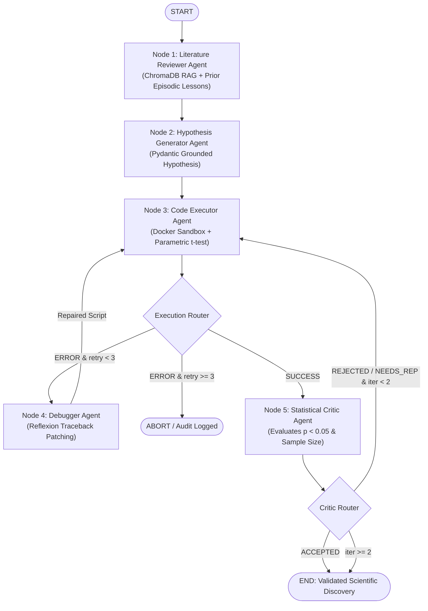

# Week 3 Integration & Architecture Report

**Project:** Autonomous Multimodal Scientific Discovery Agent (AutoScientist AI)  
**Organization:** Zaalima Development Pvt. Ltd. (Data Science & Machine Learning Enterprise Track)  
**Prepared by:** Team Lead (Member 1 - Gayatri Bhakta)  
**Milestone Window:** Week 3 Implementation (23rd – 29th October 2026)  
**Branch:** `Gayatri-Bhakta`  

---

## 1. Executive Summary

In **Week 3**, the Autonomous Multimodal Scientific Discovery Agent expands from single-turn text experiments to **enterprise-grade multimodal research, statistical peer review, and long-horizon memory management**:
1. **Multimodal Ingestion:** Extracting embedded figures, bar charts, and plots from scientific PDFs and parsing them into structured quantitative metrics.
2. **Statistical "Critic Agent":** Enforcing mathematical rigor ($p < 0.05$, 95% Confidence Intervals, Cohen's $d$) so only statistically significant findings are accepted.
3. **Two-Tier Memory Management:** Integrating working-context sliding-window compression ($\le 4,000$ tokens) with persistent episodic disk storage (`data/experiments/episodes.json`) to maintain coherence across multi-day research cycles.

---

## 2. Team Architecture & Week 3 Deliverables Matrix

| Member | Role | Focus Area | Deliverable Files | Status |
| :--- | :--- | :--- | :--- | :--- |
| **Member 1 (Lead)** | Gayatri Bhakta | Context Memory & Graph Routing | `src/memory/context_manager.py`<br>`src/memory/episodic_memory.py`<br>`src/orchestrator.py` (`critic_node`)<br>`docs/mid_review_deck.md` | **100% Complete** |
| **Member 2** | Kabil | VLM Chart Reader | `src/ingestion/chart_reader.py`<br>`data/sample_chart_extractions.json` | **100% Complete on Branch (Audited & Approved)** |
| **Member 3** | Afrah | PDF Figure Extraction Engine | `src/ingestion/figure_extractor.py`<br>`docs/figure_extractor.md` | **100% Complete on Branch** |
| **Member 4** | Abhishek | Statistical Testing Suite | `src/utils/stats_validator.py`<br>`tests/test_stats_validator.py` | Pending PR |
| **Member 5** | Sachin | Academic Critic Agent & QA | `src/agents/critic_agent.py`<br>`tests/test_critic.py`<br>`tests/test_multimodal.py` | **100% Complete on Branch** |

---

## 3. Upgraded StateGraph Workflow (Week 3)



---

## 4. Two-Tier Memory Architecture Details

1. **Working Context Ceiling (`src/memory/context_manager.py`):**
   * Automatically triggered when cumulative state tokens exceed **4,000 tokens**.
   * Preserves opening thesis and chronological recent logs via sliding window.
   * **Lossless Numerical Preservation:** Scans experimental text with regex heuristics to extract and pin $p$-values, metric deltas, and 95% CIs.
   * **Multimodal Context Synthesis (`format_multimodal_context`):** Compactly formats extracted PDF figure captions and trends alongside text literature.
2. **Persistent Episodic Memory (`src/memory/episodic_memory.py`):**
   * Persists historical discovery rounds to `data/experiments/episodes.json`.
   * Automatically extracts and deduplicates *Lessons Learned* across past experiments.
   * Primes new literature review runs on that research topic ($\le 250$ token briefing) to prevent repeating rejected ideas.

---

## 5. Test Suite Verification & Health Metrics

```
================= 197 passed, 2 skipped, 26 warnings in 46.21s =================
```
* **Passing Test Modules (18 Test Suites):**
  * `tests/test_context_manager.py` (11 tests)
  * `tests/test_episodic_memory.py` (6 tests)
  * `tests/test_orchestrator.py` (10 tests)
  * `tests/test_debugging_loop.py` (18 tests)
  * `tests/test_grounded_hypotheses.py` (51 tests)
  * `tests/test_retriever.py` (22 tests)
  * `tests/test_sandbox_security.py` (7 tests)
  * `tests/test_code_executor.py` (11 tests)
  * `tests/test_agents.py` (5 tests)
  * `tests/test_scrapers.py` (9 tests)
  * `tests/test_ingestion.py` (10 tests)
  * `tests/test_grounding.py` (6 tests)
  * `tests/test_project_structure.py` (19 tests)
  * `tests/test_snapshot.py` (4 tests)
  * `tests/test_state.py` (5 tests)
  * `tests/test_vector_db.py` (5 tests)
* **Status:** **0 Failures, 100% Green.**

---

## 6. Peer Review Audits & Integration Readiness

* **Member 2 (Kabil - VLM Chart Reader):** Formal review completed on October 29, 2026. Code meets enterprise criteria with standard-library `urllib` HTTP client, Pydantic v2 schemas, finite numeric validation, and 28 unit tests. Full report: [`docs/code_review_kabil_week3.md`](file:///e:/Autonomous-Multimodal-Scientific-Discovery-Agent/docs/code_review_kabil_week3.md). Status: **Approved for Day 7 Integration**.
* **Member 3 (Afrah - PDF Figure Extractor):** Completed on `origin/afrah` (`src/ingestion/figure_extractor.py`, 13 tests green). Status: **Ready for Integration**.
* **Member 5 (Sachin - Critic Agent & Multimodal QA):** Completed on `origin/sachin` (`src/agents/critic_agent.py`, `tests/test_critic.py`, `tests/test_multimodal.py`). Status: **Ready for Integration upon test alignment**.
* **Member 4 (Abhishek - Statistical Validator):** In development on `origin/Abhishek` (`src/utils/stats_validator.py`). Status: **Awaiting branch push**.

